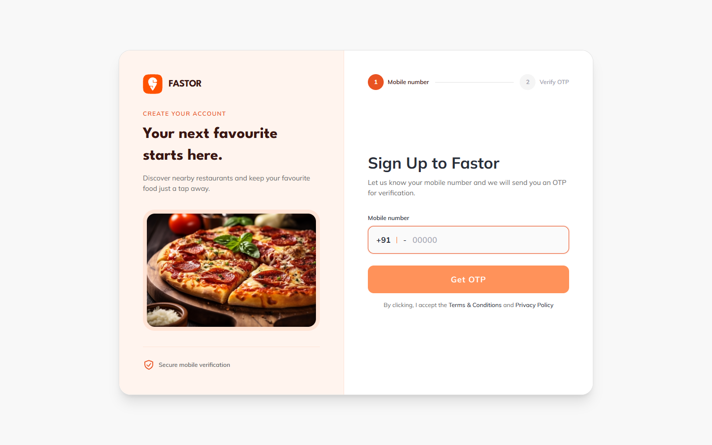
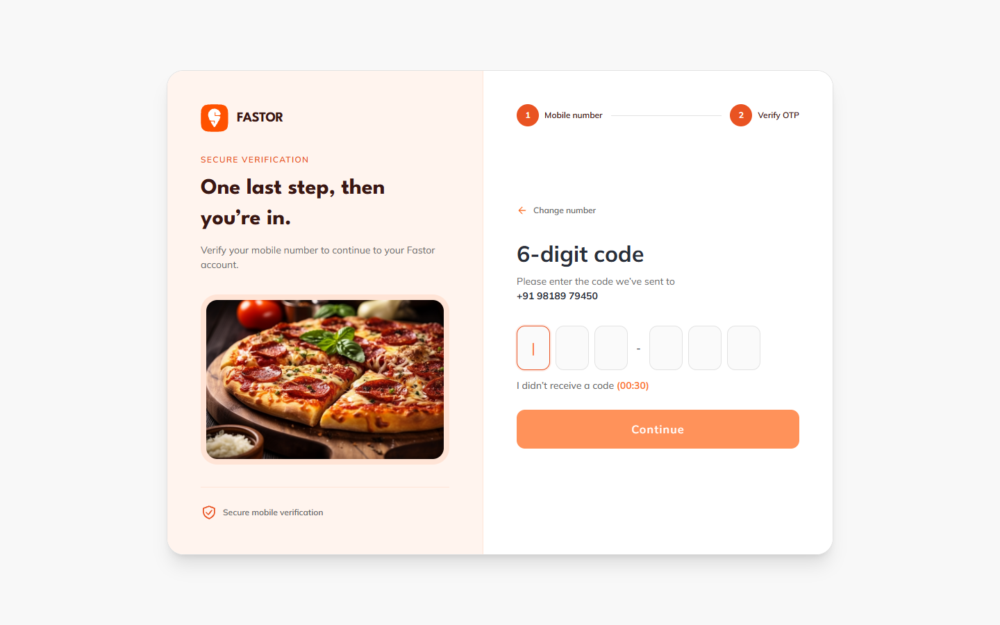
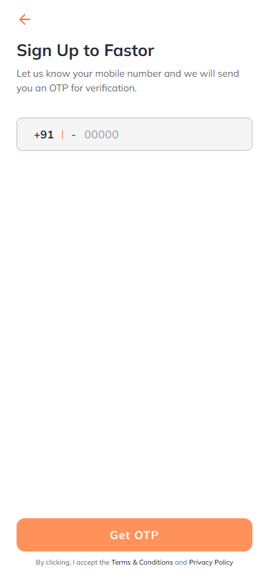
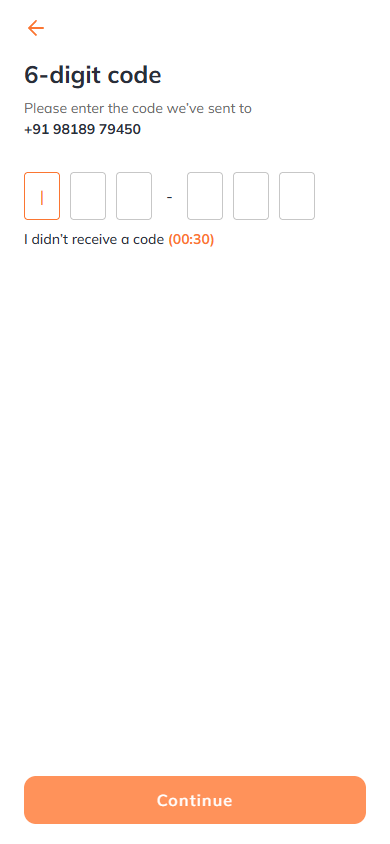

# Fastor ReactJS web app

Standalone ReactJS web app built with Vite and TypeScript. It includes responsive signup, OTP verification, dashboard, and product screens for mobile, tablet, and desktop.

## Preview

Live demo: deployment URL has not been provided yet.

Local development preview: [http://localhost:5173](http://localhost:5173) after running `npm run dev`. This is a local preview, not a hosted demo.

## Stack

- Vite 8 + React 19 + TypeScript
- Tailwind CSS 4 through `@tailwindcss/vite`
- TanStack Query for server state
- TanStack Router for typed client routes
- Zustand with persisted authentication state
- `vite-plugin-pwa` for manifest, service worker, and auto updates
- Sass available for future component-level styles
- Centralized web design tokens for Mulish, League Spartan, Inter, colors, spacing, and radii
- Fastor staging API integration for OTP registration, JWT login, and paginated restaurants

## Requirements and setup

Node.js **24.x** is required for Vercel deployments. The project is pinned to Vercel's current `24.x` build runtime; npm is also required. Vite 8 supports Node 24 for local builds.

```bash
npm ci
npm run dev
```

If working in the combined local workspace, run these commands inside `react/`. In the standalone repository, run them from the repository root.

## Test login

Use the test account from the Fastor staging API documentation:

- Mobile number: `9818979450`
- Dial code: `+91`
- OTP: `123456`

Enter the mobile number on `/`, click **Get OTP**, then enter the OTP on `/otp`. Registration and login always call the API; there is no offline authentication bypass. A valid server-issued token is required to load restaurants. Successful login depends on the staging backend being available.

## Screens and APIs

| Screen | API usage |
| --- | --- |
| Signup (`/`) | `POST /v1/pwa/user/register` with `phone` and `dial_code`. Navigate to OTP only after success. |
| OTP (`/otp`) | `POST /v1/pwa/user/login` with `phone`, `otp`, and `dial_code`. Save the returned token and profile in Zustand. Resend calls the register endpoint again. |
| Dashboard (`/dashboard`) | `GET /v1/m/restaurant?city_id=118&page_no=1` with `Authorization: Bearer <token>`. Pagination changes `page_no`; loading, error, retry, and empty states are supported. |
| Product (`/product`) | Local product presentation and quantity/portion controls; no product-detail or checkout endpoint is provided in the API documentation. |

The dashboard's Best Sellers, promotional banner, and Popular Items use local presentation data. The Restaurants Near You section uses only API results; no fake restaurant list is substituted when requests fail.

## API configuration

Copy `.env.example` to `.env` only when you need to override the default staging URL. POST requests are sent as `application/x-www-form-urlencoded`, and authentication is persisted through the Zustand store.

Local development forwards `/api` requests through the Vite proxy to `https://staging.fastor.ai`. Production uses that staging URL directly unless `VITE_FASTOR_API_URL` is configured; the Vite development proxy is not part of the production build.

### Vercel deployment

Import this repository into Vercel with the repository root as the project root. The committed `vercel.json` sets the build command to `npm run build`, output directory to `dist`, adds the SPA fallback for `/otp`, `/dashboard`, and `/product`, and forwards `/api/*` to the Fastor staging API.

Add this environment variable in Vercel for both **Preview** and **Production**:

```text
VITE_FASTOR_API_URL=/api
```

Do not add an API token: the user JWT is returned by login and stored in the browser session. After changing a Vercel environment variable, redeploy so the new value is included in the Vite build.

API errors are shown to the user; failed requests do not create a session or substitute local restaurant records. Legacy saved authentication state is reset once after this update, so existing users may need to log in again.

For static hosting, configure SPA fallback to `index.html` for `/otp`, `/dashboard`, and `/product`. The production API must allow requests from the deployed origin, or `VITE_FASTOR_API_URL` must point to a suitable hosted API proxy.

## Commands

```bash
npm ci
npm run dev
npm run lint
npm run typecheck
npm run build
```

## Structure

```text
src/
  app/                 Query client and router setup
  api/                 API clients and response types
  components/          Shared layout and UI components
  data/                Local menu presentation data
  hooks/               Authentication and restaurant queries
  pages/               Signup, OTP, dashboard, and product screens
  store/               Zustand stores
  theme/               Centralized web design tokens
  styles/              Shared styles and Tailwind theme
```

PWA output is generated during `npm run build` in `dist/`.

## Screenshots

Captured from the local web app. These show the authentication UI, not a completed live API login.

### Desktop





### Mobile



